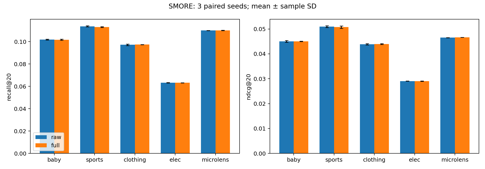

# Task 4：三种子复核结果（2026-10-31）

**20/20 次补跑已完成，无失败。结合首轮后，共 45 次真实实验：Raw/Full 各覆盖五个数据集与 seeds 999、2024、2025（30 次），三个消融仍各覆盖五个数据集、seed 999（15 次）。**

最后一次训练于北京时间 14:04:59 左右结束，队列于 14:05:17 退出。补跑墙钟约 3 小时 40 分钟，作业耗时合计 7.14 GPU 小时；没有发生 GPU 避让或重跑。未更换参数、数据、环境或模型接入方式。

## 结论

三种子结果未复现论文中跨数据集的普遍收益。20 项平均指标中 7 项提高、12 项下降、1 项持平。Recall@20 在 Baby、Sports、Electronics 小幅下降，在 Clothing、MicroLens 小幅上升。Clothing 的方向相对 seed 999 发生翻转；MicroLens 的 R@20 在三个 seed 中一次上升、两次持平。这些差异不能作为稳定收益的证据，也不能据此否定作者未公开的 SMORE 实现。

| 数据集 | Raw R@20（均值 ± 样本标准差） | Full R@20（均值 ± 样本标准差） | 均值相对变化 | 配对提高/下降/持平 |
|---|---:|---:|---:|---:|
| Baby | 0.101833 ± 0.000379 | 0.101667 ± 0.000493 | -0.164% | 1/2/0 |
| Sports | 0.113700 ± 0.000520 | 0.113033 ± 0.000451 | -0.586% | 1/2/0 |
| Clothing | 0.097133 ± 0.000666 | 0.097367 ± 0.000153 | +0.240% | 2/1/0 |
| Electronics | 0.063267 ± 0.000153 | 0.063167 ± 0.000115 | -0.158% | 0/2/1 |
| MicroLens | 0.109933 ± 0.000153 | 0.110000 ± 0.000173 | +0.061% | 1/0/2 |

仅有三个 seed，不作统计显著性结论；不挑选最佳 seed。指标继承原评价器四位小数，表中的六位小数用于呈现平均值，不代表单次测量有六位小数精度。误差条是样本标准差，不是置信区间。

## 成本与复核

| 数据集 | Raw 平均总时长（分） | Full 平均总时长（分） | Full 最大训练/评估分配显存（GiB） | Full 最大进程 RSS（GiB） |
|---|---:|---:|---:|---:|
| Baby | 5.66 | 5.89 | 1.09 | 1.69 |
| Sports | 8.94 | 9.58 | 2.67 | 1.93 |
| Clothing | 14.68 | 15.88 | 3.32 | 1.98 |
| Electronics | 55.21 | 55.89 | 9.61 | 5.69 |
| MicroLens | 21.44 | 21.50 | 1.88 | 2.52 |

时长取三个 seed 的平均总时长，包含初始化和最终测试；显存计数在初始化后重置，不覆盖稠密 KNN 构图峰值。补跑在 32–111 轮间早停。全部补跑使用干净的提交 `1e02e05f949b2e47f897ff3776805e98baec3fb7`；模型、训练代码和配置与首轮 `a039f98` 相同。首轮两次运行存在准备文件未提交的记录，详见[首轮报告](../RESULTS.md)，这些文件没有影响训练代码。

已从原始日志重新核对全部 30 次 Raw/Full：配置（除 seed、GPU、路径与版本开关）、数据指纹、环境一致；训练轮数与日志一致；最佳轮次是验证 Recall@20 首次达到最大值的轮次；最终 validation 与该轮一致。重新计算的统计量与后台生成的 CSV 全部一致。

## 接入边界与后续判断

[接入核查](../../audit_20261031/INTEGRATION_AUDIT.md)确认作者公开历史和 Zenodo 没有提供 SMORE 源码；组内共享 DAMPS 与本项目快照一致。当前实现使用 SMORE 原有模态投影，再校准，再执行原有频域融合。公开 MGCN 的 DAMPS 自带独立投影且忽略外部输入数值；它不能证明作者 SMORE 采用了相同路径。

本次保留发布代码的 AVRF 权重和 IMCF 算式；并未证明这些算式是无提升的原因。Electronics/MicroLens 使用提前声明的固定参数回退值，非论文未公开的最终调参值。若后续取得作者实际 SMORE 实现，应另立明确的接入变体进行对照，保留当前结果；本轮不追加参数搜索。

## 可复核文件

- [单次指标、时长、内存和提交](per_run.csv)：30 行；路径以 first_round/repeat_seeds 表示运行根目录。
- [均值和样本标准差](summary.csv)、[同 seed 配对差值](paired.csv)、[完整性核查](integrity.json)。
- [机器可读原始证据](evidence.json)：30 次原始结果、有效配置、数据指纹和逐轮训练/验证记录；数据和缓存路径已替换为可移植占位符。
- [环境依赖](environment.txt)、[首轮 25 配置及消融](../RESULTS.md)。Checkpoint 留在隔离运行目录，不纳入 Git。

以下是后台汇总器输出的四项指标完整对照。

---

# SMORE: three-seed validation

**Status: complete (30/30 paired raw/full runs)**

Seeds: 999, 2024, 2025. Values are mean ± sample standard deviation. Checkpoint selection uses validation Recall@20. All runs must share fixed parameters, data fingerprints and environment. Each paired difference is Full − Raw for the same seed; no seed selection or significance claim.

| Dataset | Metric | Raw | Full | Paired difference | Pairs |
|---|---|---:|---:|---:|---:|
| baby | recall@10 | 0.065967 ± 0.001193 | 0.065733 ± 0.001358 | -0.000233 ± 0.000404 | 3 |
| baby | recall@20 | 0.101833 ± 0.000379 | 0.101667 ± 0.000493 | -0.000167 ± 0.000702 | 3 |
| baby | ndcg@10 | 0.035767 ± 0.000416 | 0.035733 ± 0.000351 | -0.000033 ± 0.000321 | 3 |
| baby | ndcg@20 | 0.045000 ± 0.000361 | 0.045000 ± 0.000100 | 0.000000 ± 0.000346 | 3 |
| sports | recall@10 | 0.075967 ± 0.000473 | 0.076000 ± 0.000100 | 0.000033 ± 0.000503 | 3 |
| sports | recall@20 | 0.113700 ± 0.000520 | 0.113033 ± 0.000451 | -0.000667 ± 0.000709 | 3 |
| sports | ndcg@10 | 0.041233 ± 0.000404 | 0.041167 ± 0.000416 | -0.000067 ± 0.000252 | 3 |
| sports | ndcg@20 | 0.050933 ± 0.000379 | 0.050767 ± 0.000493 | -0.000167 ± 0.000115 | 3 |
| clothing | recall@10 | 0.066600 ± 0.000361 | 0.066267 ± 0.000802 | -0.000333 ± 0.000586 | 3 |
| clothing | recall@20 | 0.097133 ± 0.000666 | 0.097367 ± 0.000153 | 0.000233 ± 0.000643 | 3 |
| clothing | ndcg@10 | 0.036133 ± 0.000153 | 0.036033 ± 0.000153 | -0.000100 ± 0.000200 | 3 |
| clothing | ndcg@20 | 0.043867 ± 0.000289 | 0.043933 ± 0.000153 | 0.000067 ± 0.000153 | 3 |
| elec | recall@10 | 0.042567 ± 0.000306 | 0.042533 ± 0.000058 | -0.000033 ± 0.000321 | 3 |
| elec | recall@20 | 0.063267 ± 0.000153 | 0.063167 ± 0.000115 | -0.000100 ± 0.000100 | 3 |
| elec | ndcg@10 | 0.023700 ± 0.000100 | 0.023667 ± 0.000058 | -0.000033 ± 0.000153 | 3 |
| elec | ndcg@20 | 0.029067 ± 0.000058 | 0.029033 ± 0.000058 | -0.000033 ± 0.000058 | 3 |
| microlens | recall@10 | 0.071900 ± 0.000346 | 0.071967 ± 0.000058 | 0.000067 ± 0.000321 | 3 |
| microlens | recall@20 | 0.109933 ± 0.000153 | 0.110000 ± 0.000173 | 0.000067 ± 0.000115 | 3 |
| microlens | ndcg@10 | 0.036733 ± 0.000058 | 0.036833 ± 0.000058 | 0.000100 ± 0.000100 | 3 |
| microlens | ndcg@20 | 0.046533 ± 0.000058 | 0.046600 ± 0.000000 | 0.000067 ± 0.000058 | 3 |

Per-run time and memory are in `per_run.csv`. GPU peaks exclude graph-construction setup; CPU peak RSS includes setup. Metrics retain the original evaluator’s four-decimal precision. The existing 25-run ablation report is single-seed; these extra runs cover only Raw and Full. The author’s exact SMORE+DAMPS integration remains unavailable in the audited public release.

Partial summaries may contain unequal marginal sample counts; use `paired.csv` for matched pairs. See `summary.csv` for the seed list and sample count of each marginal mean.
